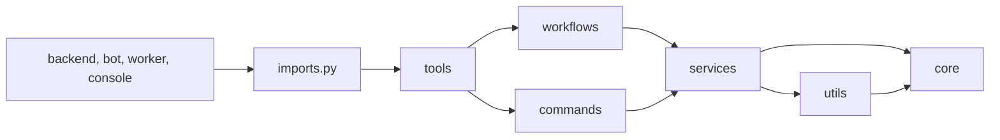

# Knik Documentation

Multi-interface AI assistant with text-to-speech, workflow scheduling, a Telegram bot and 30 AI-callable tools.

## Quick Start

```bash
npm run start:web:backend          # Web backend (port 8010)
npm run start:web:frontend         # Web frontend (port 8020)
npm run start:bot                  # Telegram bot daemon (requires KNIK_TELEGRAM_BOT_TOKEN)
npm run start:worker               # Workflow scheduler (alias: start:cron)
npm run start:console              # Terminal console
python src/main.py --mode backend  # Any process without npm: backend | bot | worker | console
```

## Documentation Index

### Guides

- [Console Application](guides/console.md) - Interactive AI chat with voice
- [Web Application](guides/web-app.md) - React frontend and FastAPI backend
- [Electron Desktop](guides/electron.md) - Electron desktop packaging
- [Tools](guides/mcp.md) - The AI-callable tools, consent gates and tool-group switches
- [Workflow Scheduler](guides/scheduler.md) - DAG workflows with natural language scheduling
- [Frontend Polish](guides/frontend-polish.md) - UI/UX implementation details

### Development

- [Setup](development/setup.md) - Installation and configuration
- [Roadmap](development/roadmap.md) - What exists and what is planned
- [Linting](development/linting.md) - Code quality and formatting
- [Deployment](development/deployment.md) - Deployment guide
- [Streaming](development/streaming.md) - Stream events, Server-Sent Events and bot streaming
- [Web Migration](development/web-migration.md) - Historical plan of the move from CustomTkinter to React

### Technical Reference

- [API Reference](reference/api.md) - AIClient, TTS, console and web endpoints
- [Environment Variables](reference/environment-variables.md) - All configuration options
- [Conversation History](reference/conversation-history.md) - Context and compaction
- [Path Aliases](reference/path-aliases.md) - Frontend import aliases
- [Tool Binding](reference/mcp-langchain-pattern.md) - How the tool registry reaches the LLM

### Architecture Plans

Proposals written before or during the backend reorganisation; paths that start with `src/apps/web/backend` refer
to the old layout (now `src/backend`).

- [Frontend Component Consolidation](plan/07-frontend-component-consolidation.md) - Centralized domain stores, canonical controls and visual migration plan
- [Web Backend Refactor](plan/04-web-backend-refactor.md) - Backend state management refactor (superseded)
- [Fix Workflow Create Page](plan/02-fix-workflow-create-page.md) - Backend workflow create endpoint
- [Settings Page](plan/03-settings-page-browser.md) - Browser and app settings UI
- [Conversation Compaction Frontend](plan/05-conversation-compaction-frontend.md) - Summarization UI in chat
- [Tool Calls Frontend UI](plan/06-tool-calls-frontend-ui.md) - Tool call/result display in chat

### Components

- [Web Architecture](components/web-architecture.md) - Frontend domain stores, widgets and component ownership
- [React Frontend](components/react-frontend.md) - React + Vite + TypeScript setup
- [React Common Components](components/react-common-components.md) - Reusable UI components
- [Electron Assets](components/electron-assets.md) - Desktop app icons and resources

### Design

- [Design](design.md) - The KNIK design system in `docs/design/`

## Source Layout

```
src/
  main.py              launcher: --mode backend | bot | worker | console (cron = worker)
  imports.py           lazy import hub, used by the apps only
  backend/             FastAPI web backend
  bot/                 Telegram bot
  worker/              workflow scheduler process
  console/             interactive terminal chat
  apps/web/frontend/   React frontend
  lib/                 shared library, layered top to bottom:
    tools/               the AI-callable tools (ToolRegistry, catalog, consent)
    workflows/           workflow engine and scheduler       commands/   shared console/bot commands
    services/            integrations: ai_client, tts, db, telegram, browser, shell
    utils/, core/        stateless helpers and Config
```



Apps never import each other, and `lib/` never imports `imports.py` or an app. A layer imports only the layers
below it; services import each other only through `services/db`. See
[Architecture](../contribution-guidelines/architecture.md) for the full rules.

## Quick Links

**User Documentation:**

- [Setup Instructions](development/setup.md)
- [Web App Guide](guides/web-app.md)

**Developer Documentation:**

- [API Reference](reference/api.md)
- [Tools](guides/mcp.md)
- [Environment Variables](reference/environment-variables.md)
