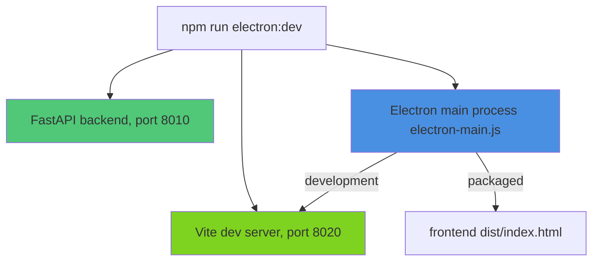

# Knik Electron Desktop App

This document explains how to run and build the Knik desktop application using Electron.

## Overview

Knik's React frontend can run in an Electron window on macOS, Windows, and Linux. In development the window
loads the Vite dev server (`http://localhost:8020`); a packaged app loads the built frontend
(`src/frontend/dist/index.html`). The packaged app contains only the frontend: it does not bundle or
start the FastAPI backend.

## Architecture



### Files

- **`electron-main.js`** - Main process (creates window, handles lifecycle)
- **`electron-preload.js`** - Preload script (exposes safe APIs to renderer)
- **`electron-builder.yml`** - Build configuration for all platforms
- **`scripts/start_electron.sh`** - Development startup script
- **`assets/`** - Platform resources; only `entitlements.mac.plist` is in the repository (see [Electron Assets](../components/electron-assets.md))

## Development

### Prerequisites

1. **Node.js dependencies:**

   ```bash
   npm install
   ```

2. **Python environment:**

   ```bash
   # Already set up if you've run the web app
   python -m venv .venv
   source .venv/bin/activate
   pip install -r requirements.txt
   ```

3. **Environment variables:**
   ```bash
   # Copy .env.example to .env and configure
   cp .env.example .env
   ```

### Running in Development Mode

**Option 1: Single command (recommended)**

```bash
npm run start:electron
```

This script:

1. Loads `.env` file
2. Activates Python virtual environment
3. Runs `npm run electron:dev`, which starts the FastAPI backend (port 8010) and the Vite dev server (port 8020)
   and opens the Electron window once port 8020 answers

**Option 2: Manual steps**

```bash
# Terminal 1: Backend
npm run start:web:backend

# Terminal 2: Frontend
npm run start:web:frontend

# Terminal 3: Electron (after backend + frontend are ready)
npx electron .
```

**Option 3: Direct npm script**

```bash
npm run electron:dev
```

### Development Features

- **Hot Reload:** Frontend changes auto-reload via Vite HMR
- **DevTools:** Opens automatically in development mode
- **Live Backend:** FastAPI auto-reloads on Python file changes
- **Console Logs:** See Electron main process logs in terminal

## Building for Production

### Build for Your Platform

```bash
# macOS (DMG + ZIP for Intel and Apple Silicon)
npm run electron:build:mac

# Windows (NSIS installer + Portable)
npm run electron:build:win

# Linux (AppImage + DEB)
npm run electron:build:linux

# All platforms
npm run electron:build
```

### Build Output

Installers are created in `dist-electron/`:

**macOS:**

- `Knik-1.0.0-arm64.dmg` - Apple Silicon installer
- `Knik-1.0.0-x64.dmg` - Intel installer
- `Knik-1.0.0-arm64-mac.zip` - Apple Silicon portable
- `Knik-1.0.0-mac.zip` - Intel portable

**Windows:**

- `Knik Setup 1.0.0.exe` - NSIS installer
- `Knik 1.0.0.exe` - Portable executable

**Linux:**

- `Knik-1.0.0.AppImage` - Universal AppImage
- `knik_1.0.0_amd64.deb` - Debian package

### Pre-Build Steps

Before building, ensure:

1. **Frontend is built:**

   ```bash
   cd src/frontend
   npm run build
   ```

2. **Icons are created:** they are not in the repository (see [Electron Assets](../components/electron-assets.md))
   - `assets/icon.icns` (macOS)
   - `assets/icon.ico` (Windows)
   - `assets/icon.png` (Linux)
   - `assets/dmg-background.png` (macOS DMG)

## Configuration

### Window Settings

Edit `electron-main.js` to customize:

```javascript
const mainWindow = new BrowserWindow({
  width: 1200, // Default width
  height: 800, // Default height
  minWidth: 800, // Minimum width
  minHeight: 600, // Minimum height
  backgroundColor: "#0a0a0a", // Background color
  titleBarStyle: "hiddenInset", // macOS style
});
```

### Build Configuration

Edit `electron-builder.yml` for:

- App metadata (name, version, author)
- Platform-specific settings
- Icon paths
- Code signing (macOS/Windows)
- Auto-update servers
- File inclusions/exclusions

### IPC Communication

To add custom IPC handlers:

**1. Add handler in `electron-main.js`:**

```javascript
ipcMain.handle("my-custom-action", async (event, data) => {
  // Perform action
  return { success: true, result: "Done!" };
});
```

**2. Expose in `electron-preload.js`:**

```javascript
contextBridge.exposeInMainWorld("electronAPI", {
  myCustomAction: (data) => ipcRenderer.invoke("my-custom-action", data),
});
```

**3. Use in React frontend:**

```typescript
// Check if running in Electron
if (window.electronAPI?.isElectron) {
  const result = await window.electronAPI.myCustomAction({ foo: "bar" });
  console.log(result);
}
```

## Platform-Specific Notes

### macOS

- **Code Signing:** Required for distribution. Set up Apple Developer account and configure `CSC_LINK` and `CSC_KEY_PASSWORD` env vars
- **Notarization:** Required for macOS 10.15+. Configure `APPLE_ID` and `APPLE_APP_SPECIFIC_PASSWORD`
- **Entitlements:** Already configured in `assets/entitlements.mac.plist`
- **DMG Background:** Add custom background image to `assets/dmg-background.png`

### Windows

- **Code Signing:** Optional but recommended. Configure `WIN_CSC_LINK` and `WIN_CSC_KEY_PASSWORD`
- **NSIS Installer:** Creates Start Menu shortcuts and Desktop icons
- **Portable:** No installation required, runs directly

### Linux

- **AppImage:** Universal format, runs on all distros
- **DEB:** For Debian/Ubuntu systems
- **Permissions:** Make AppImage executable: `chmod +x Knik-1.0.0.AppImage`

## Troubleshooting

### "Cannot find module" errors

Ensure all dependencies are installed:

```bash
npm install
```

### Backend fails to start

1. Check if port 8010 is available:

   ```bash
   lsof -ti:8010 | xargs kill -9  # Kill process on port 8010
   ```

2. Verify Python environment:
   ```bash
   source .venv/bin/activate
   python -c "import fastapi; print('FastAPI OK')"
   ```

### Frontend not loading

1. Check if port 8020 is available:

   ```bash
   lsof -ti:8020 | xargs kill -9  # Kill process on port 8020
   ```

2. Rebuild frontend:
   ```bash
   cd src/frontend
   npm install
   npm run build
   ```

### Electron window shows blank screen

1. Open DevTools in development mode (auto-opens)
2. Check console for errors
3. Verify backend is running: `curl http://localhost:8010/health`
4. Verify frontend is running: `curl http://localhost:8020`

### Build fails

1. **Missing icons:** Create icons in `assets/` (see [Electron Assets](../components/electron-assets.md))
2. **Frontend not built:** Run `cd src/frontend && npm run build`
3. **Permissions:** Ensure build scripts are executable
4. **Disk space:** Building requires ~500MB free space

## Future Features (Coming Soon)

- [ ] System tray icon with menu
- [ ] Desktop notifications for AI responses
- [ ] Global keyboard shortcuts
- [ ] Auto-update functionality
- [ ] Native file picker integration
- [ ] Offline mode support
- [ ] Multi-window support
- [ ] Screen capture/sharing
- [ ] Speech-to-text integration

## Resources

- [Electron Documentation](https://www.electronjs.org/docs)
- [Electron Builder Docs](https://www.electron.build/)
- [IPC Communication Guide](https://www.electronjs.org/docs/latest/tutorial/ipc)
- [Security Best Practices](https://www.electronjs.org/docs/latest/tutorial/security)

## See Also

- [Web App Architecture](../components/web-architecture.md)
- [Development Roadmap](../development/roadmap.md)
- [Deployment Guide](../development/deployment.md)
- [Electron Assets](../components/electron-assets.md) - Icon creation guide
- [README](../../README.md) - Project overview
