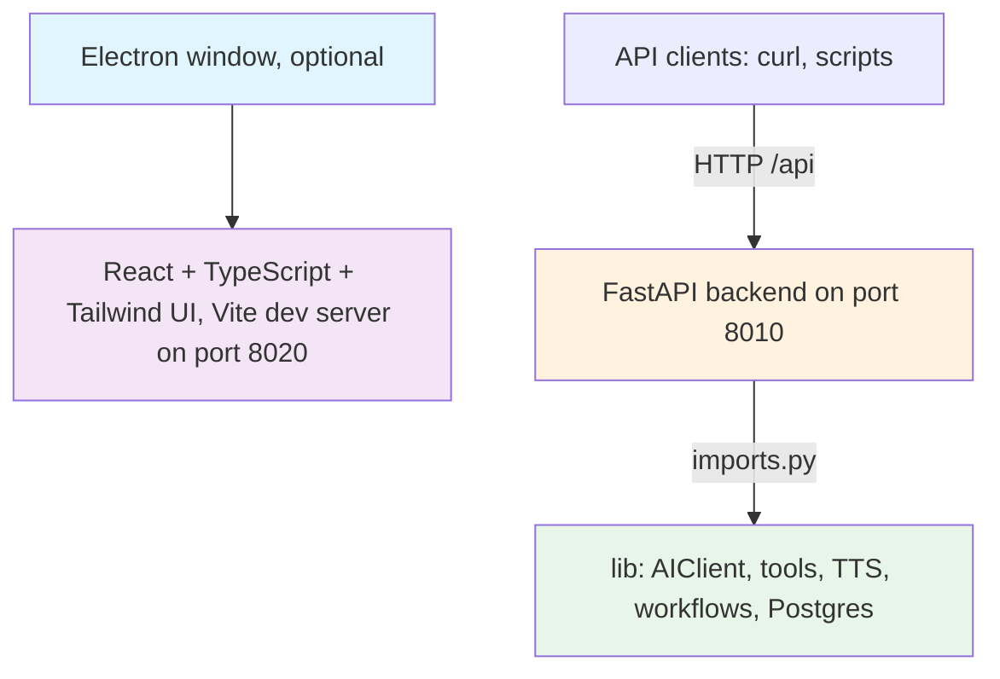

# Knik Web App

A React frontend and a FastAPI backend, run as two separate processes.

## Architecture



The frontend currently runs on an in-memory demo session (`src/lib/stores/demo/`) and does not call the
backend. The backend serves the HTTP API described below.

## Frontend (React)

### Tech Stack

- **React 19** - UI framework
- **TypeScript** - Type safety
- **Vite** (rolldown-vite) - Build tool and dev server
- **Tailwind CSS** - Utility-first styling
- **Zustand** - Domain stores

### Project Structure

```
src/frontend/src/
  App.tsx                  # Routes and layout
  main.tsx                 # Entry point
  types/                   # TypeScript type definitions
  lib/
    pages/                 # Route-level pages (Settings, WorkflowBuilder, ExecutionDetail) and the lazy route table
    widgets/               # Bind store state and actions to components
    stores/                # Provider-scoped Zustand domain stores, including the demo session
    components/            # Presentational UI, grouped by family
      buttons, chat, display, forms, graph, navigation, surfaces, ...
    hooks/                 # useKeyboardShortcuts, useViewport
    constants/
    data-structures/
    utils/
```

See [Web Architecture](../components/web-architecture.md) for the stores and widgets.

## Backend (FastAPI)

**Base URL:** `http://localhost:8010`. `/` and `/health` answer without an API key; every route under `/api`
checks `X-API-Key` when `KNIK_WEB_REQUIRE_API_KEY=true`.

| Route file         | Prefix               | Endpoints                                                                                                                                              |
| ------------------ | -------------------- | ------------------------------------------------------------------------------------------------------------------------------------------------------ |
| `chat.py`          | `/api/chat`          | POST `/` (reply text and its speech)                                                                                                                   |
| `chat_stream.py`   | `/api/chat/stream`   | POST `/` (Server-Sent Events, see [Streaming](../development/streaming.md))                                                                            |
| `admin.py`         | `/api/admin`         | GET/POST `/settings`, GET `/providers`, `/models`, `/voices`, GET `/mcp-tools`, PUT `/mcp-tools/{name}`, GET/POST `/api-keys`, DELETE `/api-keys/{id}` |
| `conversations.py` | `/api/conversations` | GET `/`, POST `/`, GET/PATCH/DELETE `/{conversation_id}`, GET `/{conversation_id}/messages`                                                            |
| `workflow.py`      | `/api/workflows`     | GET `/`, POST `/`, GET/PATCH/DELETE `/{id}`, POST `/{id}/execute`, GET `/{id}/history`, GET `/{id}/executions/{eid}/nodes`                             |
| `cron.py`          | `/api/cron`          | GET `/`, POST `/`, DELETE `/{id}`, PATCH `/{id}/toggle`                                                                                                |
| `analytics.py`     | `/api/analytics`     | GET `/dashboard`, `/metrics`, `/top-workflows`, `/executions`, `/workflows/list`, `/activity`                                                          |

FastAPI serves the interactive OpenAPI docs at `http://localhost:8010/docs`. See [API Reference](../reference/api.md),
[Tools](mcp.md) (tool consent and the tool-group switches) and [Workflow Scheduler](scheduler.md).

### Backend Structure

```
src/backend/
  main.py              # FastAPI app: CORS, the /api router with the API key check, lifespan, 503 for database errors
  config.py            # WebBackendConfig (KNIK_WEB_* and the shared Config)
  state.py             # AppState: settings, one AI client per conversation, TTS, the Scheduler
  deps.py              # get_state, require_api_key
  consent.py           # WebConsentGate (KNIK_WEB_TOOL_CONSENT)
  settings_service.py  # env, persisted and admin settings; tool-group switches
  analytics.py         # dashboard formatting
  routes/              # chat, chat_stream, admin, conversations, workflow, cron, analytics
  models/              # Pydantic request models per domain
```

When Postgres is down the backend still starts; routes that need the database answer `503` until it is back.

### Configuration

The backend reads the shared settings (provider, model, voice, database) plus its own:

```bash
KNIK_WEB_HOST=0.0.0.0           # Server host
KNIK_WEB_PORT=8010              # Server port
KNIK_WEB_RELOAD=true            # Auto-reload on code changes
KNIK_WEB_CORS_ORIGINS=http://localhost:8020,http://127.0.0.1:8020
KNIK_WEB_TOOL_CONSENT=deny      # deny or allow tools that need consent in web chats
KNIK_WEB_REQUIRE_API_KEY=false  # require X-API-Key on /api routes
```

Provider, model, voice, temperature and max tokens saved through `POST /api/admin/settings` override the
environment, from each chat's next message on. See [Environment Variables](../reference/environment-variables.md#web-backend) for all
options and how to create the first API key.

## Development

### Starting the App

```bash
# Start backend and frontend separately (two terminals)
npm run start:web:backend    # Backend on :8010
npm run start:web:frontend   # Frontend on :8020

# Or use the scripts
./scripts/start_web_backend.sh
./scripts/start_web_frontend.sh

# Or, from src/
python -m backend.main
```

There is no combined `npm run start:web` script. The backend does not run workflow schedules; start the worker
for that (`npm run start:worker`).

### Hot Reload

- **Backend:** Uvicorn reloads on code changes while `KNIK_WEB_RELOAD=true`
- **Frontend:** Vite HMR updates on file save

### Electron Desktop App

```bash
npm run start:electron    # Development mode
npm run electron:dev      # Runs backend + frontend + electron concurrently
npm run electron:build    # Build for current platform
```

See [Electron Guide](electron.md) for details.

## Troubleshooting

### Backend Won't Start

```bash
cat .env                  # Check if .env file exists
which python              # Should show .venv/bin/python
lsof -i :8010             # Check if port is available
```

### Frontend Build Issues

```bash
cd src/frontend
rm -rf node_modules package-lock.json
npm install
```

### CORS Errors

The backend allows `http://localhost:8020` and `http://127.0.0.1:8020` by default. For another origin, set `KNIK_WEB_CORS_ORIGINS` (comma-separated), e.g. `export KNIK_WEB_CORS_ORIGINS=http://localhost:YOUR_PORT`.

## Related Documentation

- [Tools](mcp.md) - AI-callable tools, consent and tool-group switches
- [Console App](console.md) - Terminal-based interface
- [Scheduler](scheduler.md) - Workflow scheduling system
- [API Reference](../reference/api.md) - Detailed API docs
- [Environment Variables](../reference/environment-variables.md) - Configuration guide
